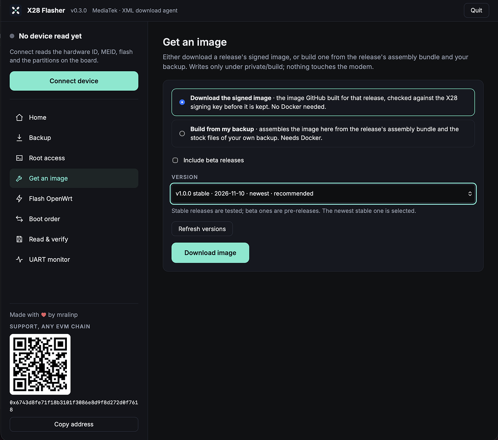
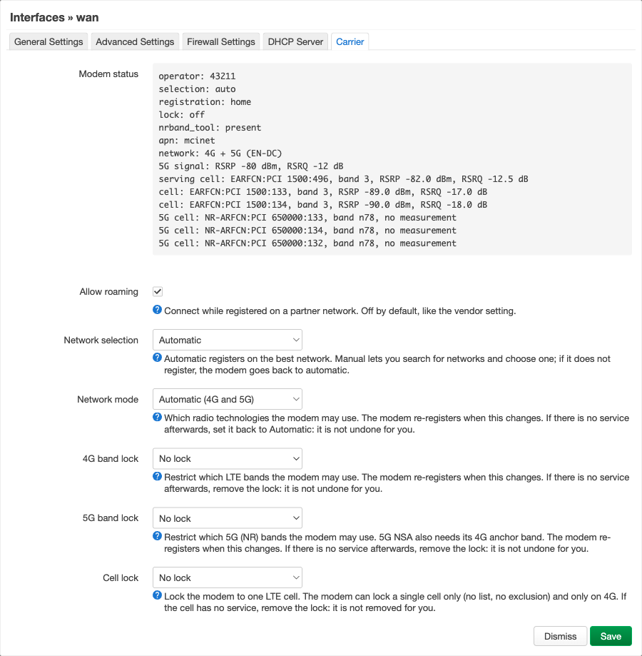
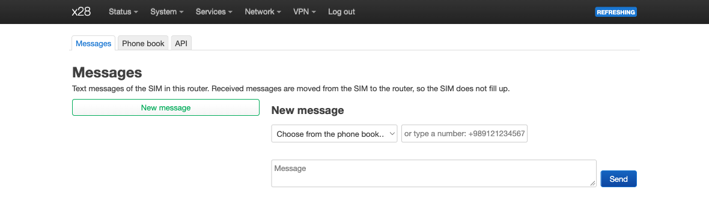

The custom firmware for the **ZLT X28 and X28 PRO is now published**, along with a desktop application for backup, installation and recovery. The first stable firmware release, `v1.0.0`, went out on November 10. As of this post, the latest stable firmware is [v1.2.2](https://github.com/mralinp/zlt-x28-openwrt/releases/tag/v1.2.2), and the desktop flasher is available as the [v0.4.3 prerelease](https://github.com/mralinp/x28-flasher/releases/tag/v0.4.3).

In [the first post](), I described getting inside the router, understanding its boot process, proving a recovery path, and bringing up OpenWrt with working 5G and VPN support. Since then, the work has moved into the parts a firmware project needs beyond its first successful boot: installation, upgrades, packages, device differences, and everyday features.

That is the milestone I wanted to reach. Someone else can now download the tools and firmware, follow a documented installation path, and configure the router through LuCI.

[Project website and downloads](https://mralinp.github.io/zlt-x28-openwrt/) · [Firmware releases](https://github.com/mralinp/zlt-x28-openwrt/releases) · [Desktop flasher](https://github.com/mralinp/x28-flasher/releases)

## What the firmware gives you

The firmware runs an **OpenWrt 23.05.5 userspace on the vendor's Linux 4.19.205 kernel**. OpenWrt owns the network configuration and service lifecycle; the vendor kernel, drivers and modem components provide the hardware backend.

That means standard LuCI pages, UCI configuration, netifd-managed cellular data, and ordinary OpenWrt networking tools on hardware that originally shipped with a much more restricted interface.

| Area | Available in the project |
| --- | --- |
| Management | LuCI over HTTPS, UCI, and LAN SSH |
| Cellular | 5G/LTE data, APN configuration, operator selection, band and LTE cell locking, signal information |
| Networking | LAN bridge, DHCP/DNS, firewall, NAT, IPv6 on LAN, and dual-band Wi-Fi |
| VPN and proxy | WireGuard, OpenVPN and Passwall2 preinstalled |
| SMS | Messages and conversations in LuCI, a phone book, and an authenticated local HTTP API |
| Maintenance | Signed firmware upgrades, a signed package feed, and factory reset |

This remains community firmware, rather than an official OpenWrt device image. Keeping the vendor kernel made the port practical, but also determines which drivers and kernel features are available.

## Installation has its own desktop application

Early in development, installing an image meant working through recovery scripts and a collection of carefully recorded steps. I moved that work into **X28 Flasher**, a separate desktop application with packages for Windows, Apple silicon macOS and Linux x86_64.

The application handles device connection, full backups, image downloads or local assembly, flashing, read-back verification, and recovery operations. Boot-slot selection is a separate action: writing an image does not silently change which slot the router boots.

<figure>
  
  <figcaption>The flasher's image-download screen. This screenshot shows an earlier v0.3.0 build and the first stable firmware release; use the current downloads linked above.</figcaption>
</figure>

There are two ways to prepare an image: download the published signed image, or assemble one locally using the open assembly bundle and the vendor files from your own verified backup. **Downloading and flashing a signed image does not require Docker.** Local image assembly and the stock-firmware root-access workflow do.

The supported installation path is the flasher and its [usage guide](https://github.com/mralinp/x28-flasher/blob/main/docs/USAGE.md). The USB connection needs a **USB-A to USB-C data cable**; USB-C to USB-C did not work with the tested download-mode setup. Make a verified full backup and keep another copy offline before writing. Flashing can leave a router unable to boot, and a backup contains that individual unit's calibration and identity: keep it private and never substitute another router's backup.

## Firmware upgrades now use both slots

The first native installation preserved the stock firmware in the other slot. Once the custom firmware could run reliably enough to develop on, the next problem was letting it update itself.

The upgrade implementation checks the image, writes the **inactive slot**, reads it back to verify the contents, and then selects it for the next boot. Signed images use OpenWrt's existing `fwtool` and `ucert` mechanisms. The package-feed trust key stays offline and certifies a separate image-signing key used for releases.

A signed **A → B → A** upgrade cycle has been exercised on the X28 test unit. LuCI now offers an update notice and upgrade action, and the command-line tools can check for and download releases. Updates require an explicit action; nothing installs automatically.

There is an important change to the recovery model: **the first inactive-slot upgrade can replace the stock firmware fallback**. Afterward, the two slots hold custom firmware versions. The original backup remains the route back to stock. Back up your configuration too; settings-preservation behavior depends on the version you are upgrading from and is not fully verified end to end. The [upgrade documentation](https://github.com/mralinp/zlt-x28-openwrt/blob/main/docs/research/sysupgrade-design.md) records those details and the remaining failure-case tests.

## Packages that match the kernel

A newer OpenWrt userspace does not make an older vendor kernel compatible with official OpenWrt kernel modules. Installing a module built for a different kernel cannot solve a missing feature.

The project now has a **signed, kernel-compatible `opkg` feed**. It provides packages for capabilities already present in the vendor kernel, modules built for this kernel, and the board-specific packages that start the modem, manage Wi-Fi, update the LEDs, and handle the boot counter.

Unsupported module dependencies are refused. This is particularly useful for VPN and proxy packages: WireGuard and the TPROXY/socket modules needed by Passwall2 are packaged for this device, rather than left as manually copied files.

The recent maintenance releases fixed two mundane but important download failures. `v1.2.1` switched package downloads to `curl` after the previous fetcher hung on GitHub's long response headers. `v1.2.2` added retries for dropped transfers. Shipping firmware also means making sure someone can actually download its next package.

The [package-feed guide](https://github.com/mralinp/zlt-x28-openwrt/blob/main/docs/PACKAGE-FEED.md) explains compatibility and the feed configuration. Signature checks should stay enabled.

## Cellular controls belong in LuCI

The cellular connection now has a Carrier tab alongside its ordinary OpenWrt interface settings. It exposes operator selection, network scanning, 4G and 5G band locks, LTE cell locking, roaming, and modem signal information, including the 5G EN-DC state.

<figure>
  
  <figcaption>Cellular settings in the WAN interface's Carrier tab. Restrictive locks can remove service; check the documentation before changing them.</figcaption>
</figure>

The X28 PRO also exposed hardware differences that the first router could not reveal. Its two-chip Wi-Fi arrangement needed different capability settings, and DHCP startup needed a guard to recover when the LAN bridge was not ready. Both models have now booted the packaged image and carried cellular data. Most detailed feature testing still comes from the original X28.

## SMS is back, with a local API

Replacing the vendor interface should not mean losing access to the SIM's messages. Since `v1.1.0`, the native image includes **`x28-telephony`**, with Messages, Phone book and API tabs under **Services → Telephony**.

Messages are shown as conversations. The backend copies received messages into the router's store before deleting them from the SIM, so the SIM's limited storage does not fill up. A local HTTP API lets another machine read or send messages using an API key.

<figure>
  
  <figcaption>The SMS interface inside LuCI, with a phone book and API configuration alongside it.</figcaption>
</figure>

On the X28 test unit, the backend imported 27 occupied SIM slots into six complete messages, including multipart Persian messages. A short outgoing message was confirmed received on a phone, and the HTTP API was checked from another machine. These tests used files installed by hand; full packaged-image coverage, Persian and multipart sending, message push, and PRO testing remain open. The [telephony notes](https://github.com/mralinp/zlt-x28-openwrt/blob/main/docs/TELEPHONY.md) distinguish those results.

Voice calls with working audio are still outside the released feature set.

## What this release means—and what remains

The project now has firmware releases, a desktop installer, signed upgrades and packages, documentation, and a [wiki](https://mralinp.github.io/zlt-x28-openwrt/wiki/). I also started a Persian article series on Sisoog; [the first installment](https://sisoog.com/zlt-x28-modem/) introduces the hardware, UART console and modem access.

The stable release label marks a project milestone, but the hardware test coverage is still small: **one X28, one X28 PRO, and one carrier**, with most feature tests on the X28. Wi-Fi throughput and broader client testing, long-duration operation, other carriers, interrupted upgrades, and fallback between two native slots still need more evidence. The vendor kernel also continues to rule out features such as nftables/firewall4 and namespaces.

What makes this milestone satisfying is how much of the work now fits together. The firmware can be installed, configured, extended and updated through tools that belong to the project. The reverse-engineering work has become something other owners can use and help improve.

If you have an X28 or X28 PRO, start with the [project website](https://mralinp.github.io/zlt-x28-openwrt/) and the [flasher guide](https://github.com/mralinp/x28-flasher/blob/main/docs/USAGE.md). Reports that include the model, firmware version, carrier and relevant logs are especially useful—remove credentials and device identifiers before posting them. The [test record](https://github.com/mralinp/zlt-x28-openwrt/blob/main/docs/TESTING.md) shows where another carefully documented result would make the biggest difference.
